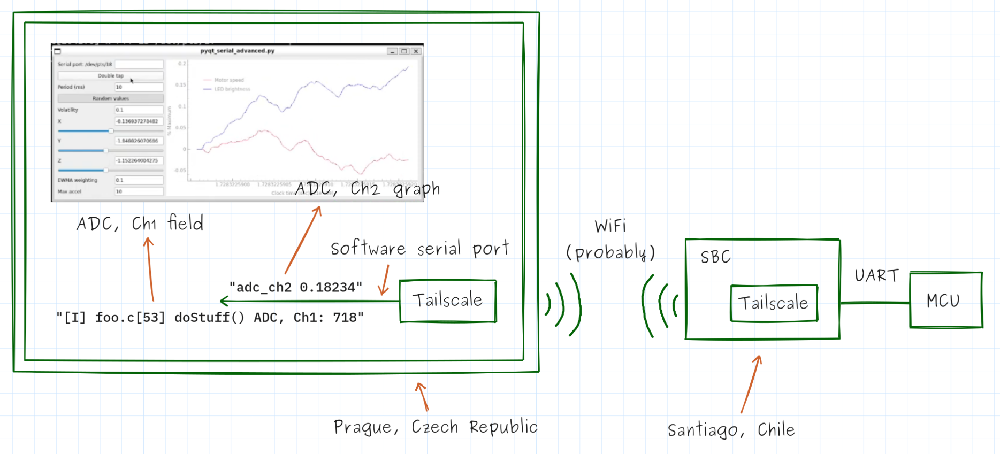

# You're Underutilizing Your Serial Port (Part 1): Logging and Telemetry

<div class="byline">
<span class="byline-author">Nathan Jones</span> · LightTurtles, LLC · October 27, 2026<br>
Originally published in <a href="https://www.embeddededit.com/article/uart-logging-telemetry-debugging">The Embedded Edit</a> · <a href="https://lightturtles.github.io/works/2026/10/27/youre-underutilizing-your-serial-port-part-1-logging-and-telemetry/">lightturtles.github.io/works</a>
</div>

[TOC]

## Introduction

The first use of the UART peripheral is often also its last: a meager `printf("Hello World!\n")` (I tend to prefer the more flavorful `"Whazzup, Nate Jones?!"`) to ensure that the peripheral is working, or an unassuming `printf("Here\n")` to see if our code ever reached our beautiful function. I think this is a shame, because a serial port is so much more than just a way to use `printf`; it's a tiny portal into the heart of your microcontroller itself! If we take a step back and consider what, exactly, a serial port is and what it's capable of, we'll find that it has uses in all manner of ways in the areas of

- logging and telemetry,
- control and configuration, and
- testing and debugging.

Transmitting logs and other data over UART is perhaps the most common use of this peripheral, so that's where we'll begin our exploration. In this article, we'll discuss ways to make `printf` more informative, we'll see how to turn it into a graphical dashboard, and you'll see how to connect to that dashboard from halfway around the world!



Let's dive in!

## A better `printf`

First off, we can do better than merely `printf("Here\n")` if we're trying to trace our program or create useful logging information. Adding a severity level (`I` = info, `W` = warning, `E` = error, etc) or a time stamp, along with the file name, line number, and function name where our descriptive message was printed, can make these statements significantly more useful.

```
[W] 35.0013 foo.c[45] doStuff() Received w = -1 (out of range)
[I] 35.0207 foo.c[53] doStuff() ADC, Ch1: 718
[E] 35.0254 main.c[123] main() Could not process sample
```

In fact, these messages might be so useful that you want to leave them in your code permanently, rather than deleting them when you're finished! If the flood of log messages in your terminal gets a little overwhelming, you could always add a global variable to disable them for certain builds, or one that controls which severity levels actually get printed.

For more information, you can read [In Defense of `printf` Debugging](https://www.digikey.com/en/maker/tutorials/2025/in-defense-of-printf-debugging) to learn why this is a valuable debugging technique or you can jump straight to [Improved `printf` Debugging](https://www.digikey.com/en/maker/tutorials/2025/improved-printf-debugging) to learn how to create the log messages shown above. If you have performance concerns about using `printf`, you can read about how to print log messages faster ([Part 1](https://www.digikey.com/en/maker/tutorials/2025/faster-printf-debugging-part-1) | [Part 2](https://www.digikey.com/en/maker/tutorials/2025/faster-printf-debugging-part-2) | [Part 3](https://www.digikey.com/en/maker/tutorials/2025/faster-printf-debugging-part-3)), with [less code](https://www.digikey.com/en/maker/tutorials/2026/smaller-printf-debugging), and in ways that are thread-safe ([Part 1](https://www.digikey.com/en/maker/tutorials/2026/thread-safe-printf-debugging-part-1) | [Part 2](https://www.digikey.com/en/maker/tutorials/2026/thread-safe-printf-debugging-part-2)).

### Verbose logging?! Over UART at 115200 baud?! Get real!

A question you might have now (and repeatedly as you read this article) is, "All this sounds great, but how realistic is it? How much data can I actually expect to move over just my UART port?" And you're right to be skeptical; at 115200 baud you can send a maximum of 11,520 bytes/sec, which may only be **209 messages/sec** if the messages above (which average 55 bytes) are typical of your system.

We can push the UART a little harder than that, though. Several of the STM32 MCUs I've developed with recently could transmit as fast as 3 megabaud (approx. **5,454 messages/sec**), which is a 26-fold improvement over 115200 baud. In truth, there's not really an upper limit on the baud rate for a UART connection. The main limitation just comes from how accurately your sender and receiver can keep their clocks matched, and from the signal integrity of your TX (transmit) and RX (receive) data lines.

To go faster, you'll probably need to look into other transport mechanisms, such as SEGGER RTT, USB full speed (FS), or USB high speed (HS). (Note that RTT works for all J-Link devices, but the J-Link EDU Mini and any J-Link on-board (OB) devices are limited in their throughput.) Also, the USB protocol is significantly more complex than UART or RTT, so you may need to really dive into the details to keep throughput high (and latency low).

| Transport layer        | ~Throughput (bytes/sec) | ~Throughput (messages/sec) |
| ---------------------- | ----------------------- | -------------------------- |
| UART, 115200 baud      | 11,520                  | 200                        |
| RTT (J-Link OB)        | 200,000                 | 3,600                      |
| UART, 3 Mbaud          | 300,000                 | 5,400                      |
| USB-FS                 | 1,000,000               | 18,000                     |
| RTT (J-Link Ultra/Pro) | 2,000,000               | 36,000                     |
| USB-HS                 | 15,000,000              | 272,000                    |

These are rough practical throughput figures rather than protocol-level maximums; actual throughput depends heavily on the implementation, buffering, packet sizes, and host/device software.

> **🗸 Spec the system**
>
> A different system has messages that average 154 bytes/message and its developers want to transmit a minimum of 6,400 messages/sec. Which transport mechanism operates just barely fast enough to meet that requirement? (Answer[^1])

See the "Faster `printf` Debugging" articles above ([Part 1](https://www.digikey.com/en/maker/tutorials/2025/faster-printf-debugging-part-1) | [Part 2](https://www.digikey.com/en/maker/tutorials/2025/faster-printf-debugging-part-2) | [Part 3](https://www.digikey.com/en/maker/tutorials/2025/faster-printf-debugging-part-3)) for more information about this topic. Those articles describe additional ways to improve the throughput of your logs, such as

- Transmitting the data in a non-blocking/buffered manner
- Compressing the data being sent in different ways
- Testing your firmware (temporarily) on a development board with a faster processor

If you need to go even faster than that, you might be thinking you need to move up to an application-level processor with wired Ethernet, but there's an easier solution! Just simulate your embedded system on your host computer.


The virtual baud rate is basically "as fast as your processor can copy memory from one process to another", which is often in the 100s of MB/s to GB/s range. Sure, you may need to mock the hardware devices your MCU is supposed to be talking to (which can be done in a number of ways; we'll discuss one such option in a future article and you can also read my other posts on EmbeddedRelated.com called "Simulating Your Embedded Project on Your Computer" [[Part 1](https://www.embeddedrelated.com/showarticle/1695.php) | [Part 2](https://www.embeddedrelated.com/showarticle/1697.php)]), but you can still get lots of useful data about your system this way. When you absolutely have to run on real hardware, just turn down the logging stream and limit what else is trying to use your UART or USB port.

## Building an MCU dashboard

A terminal isn't the only way to look at log messages! We can also use GUI software to parse the log messages for data values and present them to us in a graph or other graphical widget. For example, we could build this dashboard using PyQt or a Web Serial-capable web browser such as Chrome, Edge, or Opera.


(The neat part of using a web browser is that folks don't need to install any special software to be able to talk to the MCU!)

The GUI would read messages from the UART port, figure out what data values they contain, and then update the correct widgets accordingly.


These messages that contain our data values *could* be full log messages, as in the last section, but they don't have to be. We could also send simplified data messages that only need to specify which data value they're sending and what the value is: `<data name> <val>` (like `"adc_ch2 0.18234"`, above). And, actually, messages don't even need to be human-readable, either; they could be sent using a purely binary encoding.

```
ASCII data message: "adc_ch1 718\n" <-- 12 bytes
Binary data message: 04 01 02 CE 00 <--  5 bytes
                     ^  ^  ^     ^
                     |  |  |     |
                     |-----------|
                        |  |     Framing bytes (COBS)
                        |  718, base 10 = 0x02CE (transmitted in big-endian format)
                        01 = Value indicating this is an "adc_ch1" message
```

Typically, binary data will be more compact than the comparable ASCII message (as shown above), though at the cost of some added complexity in serializing and deserializing the data.

> **⇆ How else do they differ?**
>
> Compare and contrast the two messages above (ASCII vs binary). What are some of their relative advantages and disadvantages, besides "information density" and "complexity to serialize/deserialize"? What are some situations in which you'd prefer to use the ASCII messages? The binary messages?

We can also build a GUI using the open-source [Scrutiny Debugger](https://scrutinydebugger.com/), which uses instrumentation in the MCU firmware to read and write memory through a custom serial protocol, meaning we don't even need to send specific log messages to see our data values.


In the screenshots above, you can see that the Scrutiny GUI program can display MCU data as a:

- Live graph
- Nested list of values
- Color indicator
- Linear gauge
- Numerical display
- Radial gauge

## Observing an MCU remotely

In actuality, we don't even need to be physically co-located with our device to see our dashboard! If we connect our MCU to a small, internet-connected single-board computer (SBC) (such as a Raspberry Pi Zero 2 W) and then connect to that SBC using a VPN such as [Tailscale](https://tailscale.com/), we can use `usbip` on Linux (or `usbip-win2` on Windows) to attach the MCU's USB serial port to our laptop (through the VPN) as if it were plugged in locally, from anywhere in the world!


> **⚠️ A note about security ⚠️**
>
> VPNs like Tailscale, by definition, will encrypt all traffic to/from the endpoint. Additionally, many VPNs provide ample security features that allow you to give access and read/write permissions to individuals or groups of people, such as developers, management, or clients who want/need to access the MCU in some way.

## Conclusion

> **🛠️ Let's build!**
>
> - What's one technique you want to try on your next project?
> - What do you think will most likely stand in your way of trying out that technique?
> - What's one thing you can do in the next **5 minutes** to make it easier for you to overcome that hurdle?

There's a lot more to `printf` than just `printf("Here\n")`! With just the techniques listed here, you can start to get significantly more and better information off your MCU than before, and from anywhere in the world (how cool would it be to open a live GUI connected to your MCU on the other side of the world?!).

And it's particularly interesting to me that none of these techniques are necessarily more complicated than `printf(something)`; it just turns out we can do some pretty neat things when we get creative with:

- What that `something` is
- How we display that `something`
- How we connect to the serial port that's printing the `something`

This is not your grandma's `printf`, friends!

I hope I've been able to share with you at least one valuable technique that will help you develop your next big project. If you've made it this far, thanks for reading and happy hacking!

<div class="colophon">
<br>
<strong>Nathan Jones</strong> is the founder of LightTurtles, LLC, which offers embedded<br>systems consulting, education, and technical writing.<br>
More articles: <a href="https://lightturtles.github.io/works/">lightturtles.github.io/works</a> · Contact: <a href="mailto:contact@lightturtles.com">contact@lightturtles.com</a><br>
© 2026 LightTurtles, LLC. All rights reserved.
</div>


[^1]: USB-FS
